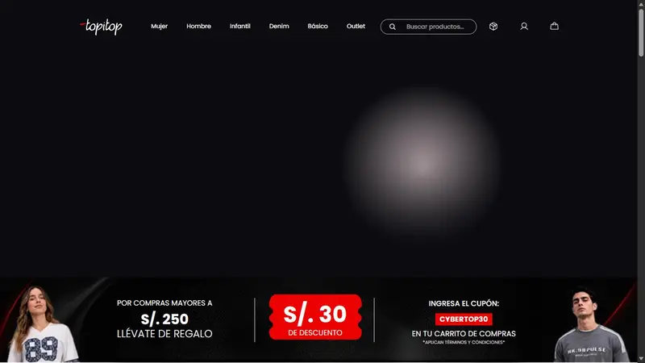

# Entrada animada del hero

Al cargar la portada, los dos modelos entran caminando y terminan en la pose de la foto:

1. El foco se enciende sobre el estudio vacío.
2. Ella entra por la izquierda y él por la derecha, con el brazo colgando. La sombra de él
   cruza la pared.
3. Se encuentran y reaccionan: ella se inclina hacia él y ríe, él se inclina y le apoya el brazo
   en el hombro.
4. Entra el título «CYBER TOP» y las capas se funden con la foto, que queda en su pose.

Dura unos 4,3 segundos. Se ve una vez por carga de página: al volver a la portada desde otra
sección queda la foto fija. Quien pide menos movimiento en su sistema ve la foto directamente.



## Cómo está hecha

No es un video: son capas recortadas de la misma foto del hero, animadas con CSS.

| Capa | Archivo | Qué es |
|---|---|---|
| Estudio | `estudio.webp` | La pared con el foco, sin personas ni sombras |
| Sombra | `sombra.webp` | La sombra de él en la pared |
| Ella | `ella.webp` | Ella recortada, con el hombro reconstruido bajo el brazo de él |
| Brazo colgando | `brazo-colgando.webp` | El brazo izquierdo de él, espejado: lo lleva colgando al caminar |
| Brazo | `brazo.webp` | El brazo de él apoyado en el hombro de ella (la pose final) |
| Él | `el.webp` | Él recortado, sin ese brazo |

Las capas están en `src/modules/promociones/assets/entrada/` y pesan unos 95 KB en total.
Todas miden lo mismo que la foto (1300 × 658). Por eso, en su lugar, reconstruyen la foto:
la diferencia media es de 1,7 sobre 255.

La coreografía y sus tiempos están en
[EntradaCaminando.css](../../src/modules/promociones/components/HeroCampania/EntradaCaminando.css).
El componente espera a que todas las capas estén listas antes de empezar. Si no lo están en
2,5 segundos, muestra la foto con el foco que se enciende.

## Cómo se generaron las capas

Con los scripts de [scripts/](./scripts) y dos modelos abiertos que corren en la CPU con
`onnxruntime`. No hace falta tarjeta gráfica.

| Paso | Script | Modelo |
|---|---|---|
| 1. Recortar a las personas | `segmentar.py` | [ISNet](https://github.com/xuebinqin/DIS) (`isnet-general-use.onnx`, de [rembg](https://github.com/danielgatis/rembg)), Apache-2.0 |
| 2. Estudio vacío | `fondo.py` | [LaMa](https://github.com/advimman/lama) (`lama_fp32.onnx`, de [Carve/LaMa-ONNX](https://huggingface.co/Carve/LaMa-ONNX)), Apache-2.0 |
| 3. Dividir en ella, él y brazo | `capas.py` | — |
| 4. Exportar las capas | `exportar.py` | LaMa, para el hombro de ella |
| 5. Brazo colgando | `brazo_colgando.py` | — |

El estudio vacío no sale solo de LaMa, porque LaMa inventaba sombras donde estaban los
modelos. La pared y el foco se modelan con polinomios suaves y el borde del círculo ajustado a
la foto. Una interpolación armónica empalma ese modelo con los bordes visibles. LaMa queda solo
para el piso.

Para regenerarlas (por ejemplo, con otra foto de campaña):

1. Crea una carpeta de trabajo con los dos modelos en `modelos/` y copia los scripts en `anim/`.
2. Instala `numpy`, `pillow`, `opencv-python-headless` y `onnxruntime`.
3. Ejecuta los scripts en orden, pasando la carpeta de trabajo:

   ```bash
   python anim/segmentar.py <carpeta>
   python anim/fondo.py <carpeta>
   python anim/capas.py <carpeta>
   python anim/exportar.py <carpeta>
   python anim/brazo_colgando.py <carpeta>
   ```

Con otra foto hay que volver a medir y escribir a mano tres cosas:
- en `capas.py`, los polígonos del límite entre los modelos y del brazo;
- en `fondo.py`, la sombra y el círculo del foco;
- en `EntradaCaminando.css`, los puntos de la coreografía (dónde pisa cada uno y dónde está el
  hombro).

## Derechos

Las personas son las de la foto de la campaña del diseño. La animación es para la demostración
de la tesis; para publicarla se necesita el permiso de la marca y de los modelos.
