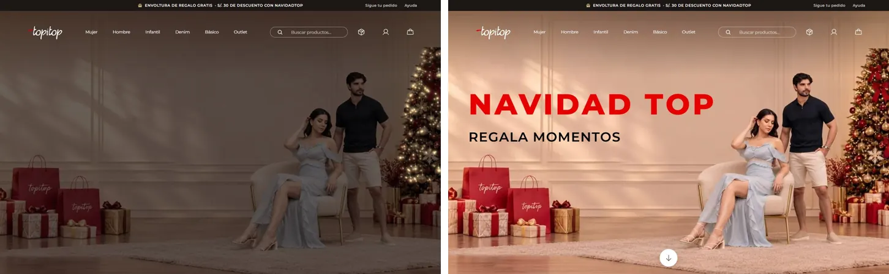

# Hero de Navidad Top

La foto del hero es la imagen original de la campaña (1376 × 768), sin logo, menú ni textos: la
página los dibuja en HTML. Reemplazó a la primera versión, que se había limpiado a partir de una
captura del diseño.

Al cargar la portada, la sala aparece en penumbra y las luces del árbol se encienden en tres
grupos. Después la sala se aclara y entra el título «NAVIDAD TOP / REGALA MOMENTOS». Las luces
titilan unos segundos y se apagan; la foto ya las trae encendidas. Todo dura unos 5 segundos y
se ve una vez por carga de página. Si la persona pidió menos movimiento en su sistema, ve la foto
directamente.



## Archivos

| Archivo | Qué es |
|---|---|
| `src/modules/promociones/assets/navidad/navidad-hero.webp` | La foto original, 1376 × 768, en WebP (79 KB) |
| `src/modules/promociones/assets/navidad/luces-1.webp`, `-2`, `-3` | Las luces del árbol con su halo, en tres grupos, sobre transparente |

Las luces cubren la caja `x 1212, y 80, 164 × 446` de la foto, anotada en
`src/modules/promociones/data/campanias.ts`. El CSS reproduce el recorte de la foto con unidades de
contenedor, así que las luces calzan a cualquier tamaño de pantalla.

## Cómo se generan las luces

`scripts/luces.py` busca en el árbol los puntos cálidos más brillantes que su entorno. Descarta los
brillos grandes de las bolas, los reparte al azar en tres grupos, les da un halo y guarda las tres
capas recortadas a la zona del árbol. Al final imprime la caja para copiarla en `campanias.ts`.

```bash
python scripts/luces.py <carpeta>                    # la carpeta tiene foto-limpia.png
python scripts/luces.py <carpeta> 1228 96 1376 510   # zona del árbol: x0 y0 x1 y1, en píxeles de la foto
```

Para cambiar la foto: guardar `navidad-hero.webp`, actualizar `ancho` y `alto` en `campanias.ts`,
volver a generar las luces con la zona del árbol de la foto nueva y copiar la caja que imprime.

`scripts/mascara.py` y `scripts/rellenar.py` quedan de la primera versión. Borraban la interfaz de
una captura del diseño con el modelo abierto [LaMa](https://github.com/advimman/lama)
(`lama_fp32.onnx`, de [Carve/LaMa-ONNX](https://huggingface.co/Carve/LaMa-ONNX), Apache-2.0). Con
la foto original ya no hacen falta, pero sirven si solo se tiene una captura.
